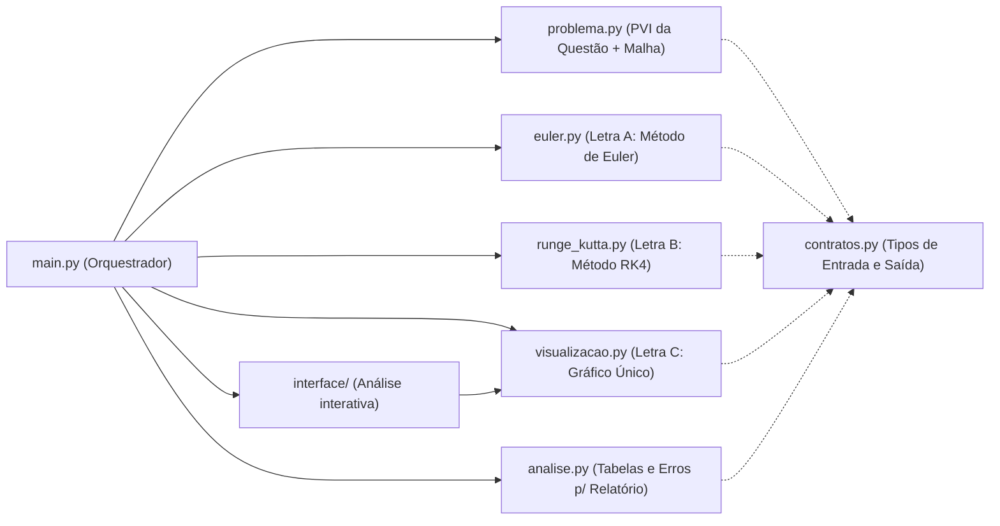

# Trabalho 1 — Modelagem Matemática (BCC 2026.1)

Repositório do **1º Trabalho de Implementação Computacional** da disciplina de **Modelagem Matemática** (UFAPE — Prof. Sansuke Watanabe).

- **Enunciado:** [docs/1-Trabalho_Implementacao_Modelagem_Matematica_BCC_2026_1-1VA.pdf](./docs/1-Trabalho_Implementacao_Modelagem_Matematica_BCC_2026_1-1VA.pdf)
- **Material de referência (Apostila EDOs):** [docs/Edo_Sansuke_com_figura_Atualizado.pdf](./docs/Edo_Sansuke_com_figura_Atualizado.pdf)
- **Prazo de entrega:** 30/11/2026 às 20h (código-fonte em Python + PDF do relatório).

## Como executar

```bash
python -m venv .venv
.venv/bin/pip install -r requirements.txt   # matplotlib + customtkinter (requer Tk, já incluso no Python do sistema)

.venv/bin/python main.py                    # resolve, imprime a tabela de erros e salva resultados/comparacao_pvi.png/.pdf
.venv/bin/python main.py --interativo       # também abre a interface de análise do gráfico
.venv/bin/python main.py --interativo --sem-guia
.venv/bin/python -m pytest -q               # testes
```

**Interface de análise (`--interativo`):** um guia de boas-vindas apresenta o problema, os eixos, os filtros e a inspeção de pontos. Na barra lateral escolhem-se as curvas exibidas, o intervalo de x, as escalas (linear/log), o tipo de erro (absoluto/relativo) e o passo h (que recalcula Euler e RK4). Clicar no gráfico seleciona o nó da malha mais próximo, e as setas ← → navegam entre os nós. O cartão inferior mostra φ(xₙ), o valor de cada método, os erros e a razão entre eles. "Exportar figura" salva a visão atual em PNG, PDF ou SVG.

---

## 1. Definição Matemática do Problema

Devemos resolver numericamente o seguinte **Problema de Valor Inicial (PVI)**:

$$
\begin{cases}
y' + 2y = e^{-x} \\
y(0) = 3
\end{cases}
$$

- **Forma explícita de Cauchy** exigida pelos métodos numéricos:
  $$y' = f(x, y) = e^{-x} - 2y$$
- **Intervalo:** $0 \leqslant x \leqslant 5$
- **Passo de integração:** $h = 0.1$ ($N = 50$ passos $\implies$ **51 pontos discretos**, de $x_0 = 0.0$ até $x_{50} = 5.0$)
- **Solução analítica exata** (para comparação e cálculo de erro):
  $$\varphi(x) = e^{-x} + 2e^{-2x}$$

### Itens solicitados
- **(a)** Resolver o PVI pelo **Método de Euler**.
- **(b)** Resolver o PVI pelo **Método de Runge-Kutta** (4ª ordem clássico — RK4, conforme Seção 8.2 da apostila).
- **(c)** Plotar em um **mesmo gráfico (*frame*)** as três soluções: **Exata**, **Euler** e **Runge-Kutta**.
- **Relatório:** Breve descrição teórica, comentários sobre os resultados obtidos e inclusão do gráfico comparativo.

---

## 2. Decisão Técnica: Padrão de Tipos e Bibliotecas

Para manter o código simples, didático e sem conflitos de ambiente entre os integrantes:

1. **Núcleo matemático (`contratos`, `problema`, `euler`, `runge_kutta`, `analise`):**
   - Usaremos **Python puro**: listas nativas `list[float]`, biblioteca padrão `math` (`math.exp`), `dataclasses` e `typing`.
   - **Motivo:** Com apenas 51 pontos, a execução em Python puro leva frações de milissegundo, deixa as fórmulas de recorrência 100% explícitas (como na apostila do professor), evita bugs de conversão entre `ndarray` e `list`, e permite desenvolver/testar os métodos sem instalar pacotes externos.
2. **Visualização (`visualizacao`):**
   - Usaremos **`matplotlib`**, que já aceita `list[float]` diretamente na plotagem sem necessidade de conversão.
3. **Interface de análise (`interface`):**
   - **`customtkinter`** com o `matplotlib` embutido (`FigureCanvasTkAgg`). Ela recebe os dados prontos e um callback `recalcular(h)` do `main.py`, então também não importa solvers nem `analise`.

---

## 3. Arquitetura Modular

O projeto é dividido em módulos independentes conectados por um **Contrato de Dados** comum, evitando que uma pessoa trave o desenvolvimento da outra ou gere conflitos de Git.



> [!IMPORTANT]
> **Regra de Ouro da Dependência:** Os módulos `euler.py`, `runge_kutta.py`, `visualizacao.py` e `analise.py` **nunca importam uns aos outros**. Todos conhecem apenas `contratos.py`, e quem conecta a saída de um na entrada do outro é exclusivamente o `main.py`.

### Estrutura de Diretórios Planejada

```text
projeto-modelagem/
├── docs/                        # Enunciado da 1ª VA e apostila de referência
├── relatorio/                   # Arquivos editáveis e PDF final do relatório
├── resultados/                  # Saídas geradas (gráfico comparativo .png/.pdf e tabelas)
├── src/
│   ├── __init__.py
│   ├── contratos.py             # Estruturas ProblemaPVI, ResultadoMetodo e CenarioComparacao
│   ├── problema.py              # Equação f(x,y), solução exata e geração da malha x
│   ├── analise.py               # Cálculo de erros absolutos e resumo tabular p/ o relatório
│   ├── visualizacao.py          # Letra (c): gráfico comparativo das 3 curvas no mesmo frame
│   ├── interface/               # Janela interativa: filtros, inspeção de pontos e guia de onboarding
│   └── metodos/
│       ├── __init__.py
│       ├── euler.py             # Letra (a): implementação exclusiva do Método de Euler
│       └── runge_kutta.py       # Letra (b): implementação exclusiva do Runge-Kutta (RK4)
├── tests/                       # Testes isolados de validação para cada módulo
├── main.py                      # Ponto único de entrada (executa o fluxo completo)
├── requirements.txt             # Dependências externas (ex: matplotlib)
└── README.md
```

---

## 4. Contratos de Interface (`src/contratos.py`)

Para que todos possam programar em paralelo desde o primeiro dia, todo módulo deve respeitar rigorosamente estes dois formatos de dados:

### 4.1. `ProblemaPVI` (Entrada dos métodos)
Estrutura (`dataclass`) que descreve qualquer PVI de 1ª ordem $y' = f(x, y)$:
- `f`: `Callable[[float, float], float]` — função derivada $f(x, y)$.
- `x0`: `float` — valor inicial de $x$ (`0.0`).
- `y0`: `float` — condição inicial $y(x_0)$ (`3.0`).
- `x_fim`: `float` — limite final de $x$ (`5.0`).
- `h`: `float` — passo de integração (`0.1`).
- `solucao_exata`: `Callable[[float], float] | None` — função analítica $\varphi(x)$, usada na análise e no gráfico.

### 4.2. `ResultadoMetodo` (Saída padronizada dos métodos)
Estrutura (`dataclass`) devolvida tanto pelo Euler quanto pelo Runge-Kutta (e também para representar a curva discreta exata, se desejado):
- `nome`: `str` — nome legível para legendas e tabelas (ex: `"Método de Euler"`, `"Runge-Kutta (RK4)"`).
- `x`: `list[float]` — lista dos pontos da malha ($x_0, x_1, \dots, x_n$).
- `y`: `list[float]` — lista dos valores calculados ($y_0, y_1, \dots, y_n$).

**Invariantes obrigatórias de todo solver:**
1. Não alterar os dados de entrada.
2. Não fixar a equação $e^{-x} - 2y$ dentro do solver (sempre chamar `pvi.f(x, y)`).
3. Retornar `len(x) == len(y) == 51`, começando exatamente em `x[0] == pvi.x0` e `y[0] == pvi.y0`.

---

## 5. Divisão do Grupo (4 Integrantes) e Como Trabalhar sem Bloqueios

Cada integrante é dono dos seus próprios arquivos, eliminando conflitos de merge:

| Frente | Responsável | Branch Sugerida | Arquivos de Responsabilidade | Como testar/avançar sem depender dos outros |
| :--- | :--- | :--- | :--- | :--- |
| **1. Estrutura + Letra (a)** | Integrante 1 | `feat/estrutura-base` e depois `feat/metodo-euler` | `src/contratos.py`, `src/problema.py`, `main.py`, `src/metodos/euler.py`, `tests/test_euler.py` | Validar $f(0, 3) = -5$, $\varphi(0) = 3$, malha com 51 pontos exatos e 1º passo manual de Euler: $y_1 = 3 + 0.1(-5) = 2.5$. |
| **2. Letra (b) — RK4** | Integrante 2 | `feat/metodo-rk4` | `src/metodos/runge_kutta.py`, `tests/test_rk4.py` | Seguir Seção 8.2 (pág. 10) da apostila (`Kn1`..`Kn4`). Validar $y_1 \approx 2.542305$ e checar se ao dividir $h$ por 2 o erro cai $\approx 16\times$. |
| **3. Letra (c) — Gráfico** | Integrante 3 | `feat/visualizacao` | `src/visualizacao.py` | Criar objetos `ResultadoMetodo` simulados (mock) para ajustar layout, cores, marcadores, legenda e salvamento em `resultados/` antes mesmo de A e B terminarem. |
| **4. Relatório + Análise** | Integrante 4 | `docs/relatorio` | `relatorio/`, `src/analise.py` *(opcional p/ gerar tabela de erros)* | Redigir introdução do PVI, resumo teórico de Euler (Seção 5), RK4 (Seção 8.2) e análise de erros local/acumulado (Seção 6), deixando espaço para a tabela e o gráfico final. |

### Ordem Recomendada no Git

1. **Passo 1 (Rápido — Integrante 1):** Subir e fazer merge da `feat/estrutura-base` contendo apenas as pastas vazias, `requirements.txt`, `src/contratos.py` e `src/problema.py`.
2. **Passo 2 (Todo mundo em paralelo):** Cada integrante cria sua branch a partir da `main` atualizada e desenvolve seu módulo isoladamente.
3. **Passo 3 (Integração final):** Conforme os Pull Requests de `euler`, `rk4` e `visualizacao` entrarem na `main`, conecta-se tudo no `main.py` para gerar a figura oficial e os dados finais do relatório.

---

## 6. Pontos de Atenção na Implementação

> [!TIP]
> **1. Evitem `while x <= 5.0` somando `x += 0.1`:**
> Em ponto flutuante binário, somar `0.1` repetidamente acumula imprecisão (`4.999999999999999` vs `5.000000000000001`), fazendo um método gerar 50 pontos e outro 51. Calculem o número inteiro de passos `n_passos = round((x_fim - x0) / h)` e gerem cada ponto por índice: `round(x0 + i * h, 10)` para `i` de `0` até `n_passos` (centralizado em `problema.py`).

- **2. Visibilidade das 3 curvas no gráfico (Letra c):** Com $h = 0.1$, a aproximação do Runge-Kutta tem erro máximo na casa de $10^{-5}$ e fica visualmente sobreposta à Solução Exata. Usem estilos distintos (por exemplo: linha contínua para a Solução Exata, linha tracejada com marcadores para Euler e marcadores vazados/pontilhados para o RK4) para que as **três** curvas fiquem claramente visíveis no mesmo *frame*.
- **3. Curva Exata suave vs. pontos discretos:** Na tabela comparativa de erros avaliamos $\varphi(x_n)$ nos 51 pontos da malha; já no gráfico, vale avaliar $\varphi(x)$ numa malha mais densa (ex: 500 pontos entre `0` e `5`) para desenhar a curva analítica contínua e suave sob os pontos discretos de $h = 0.1$.
